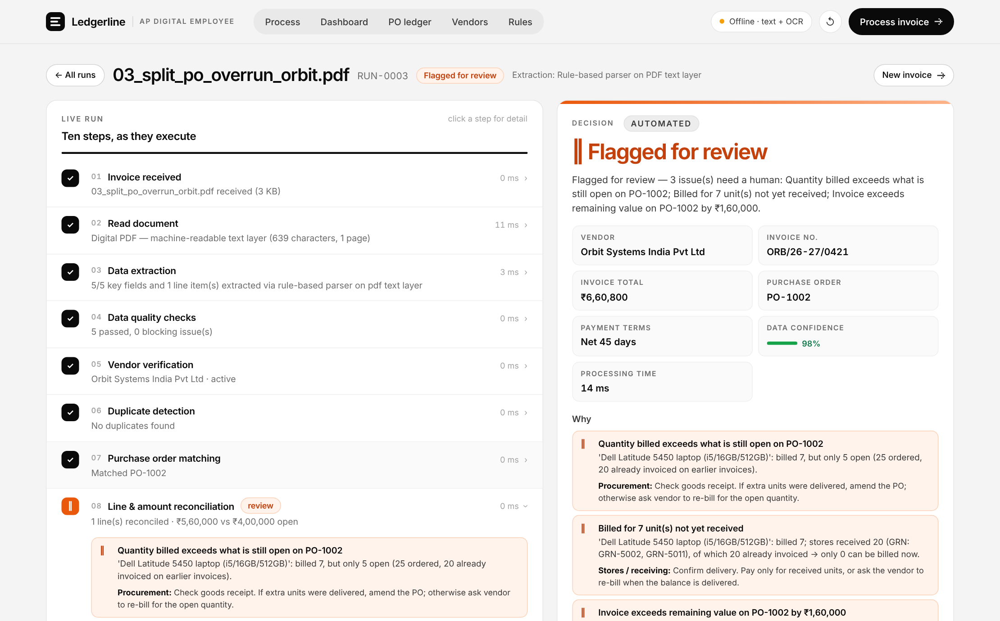
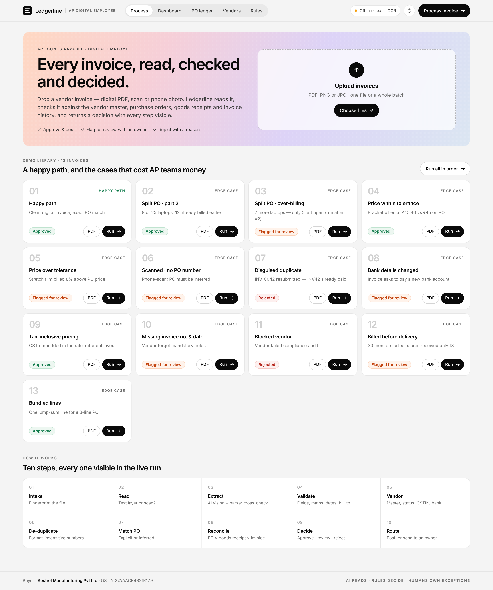
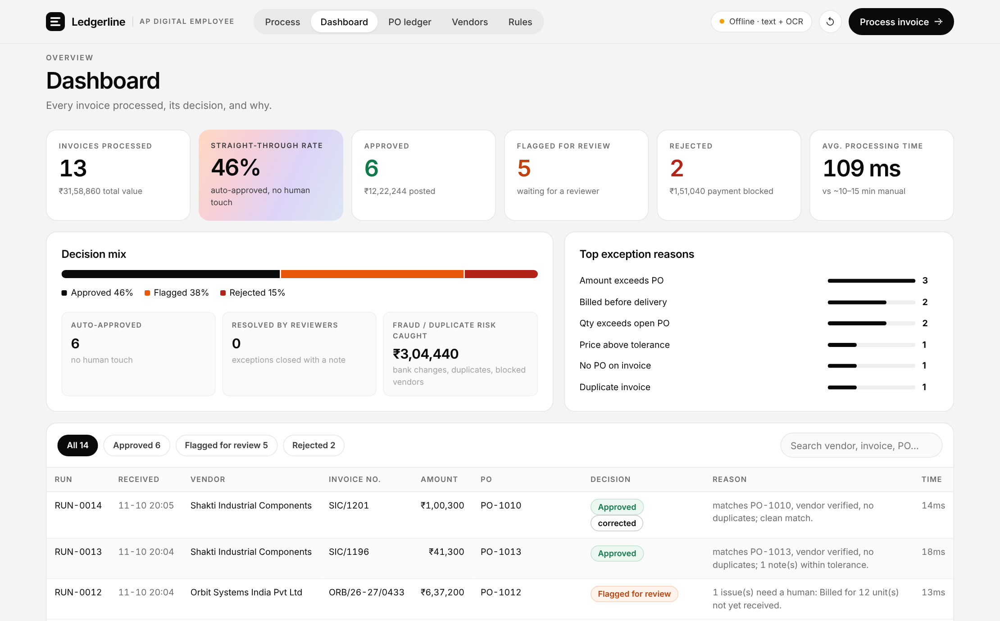
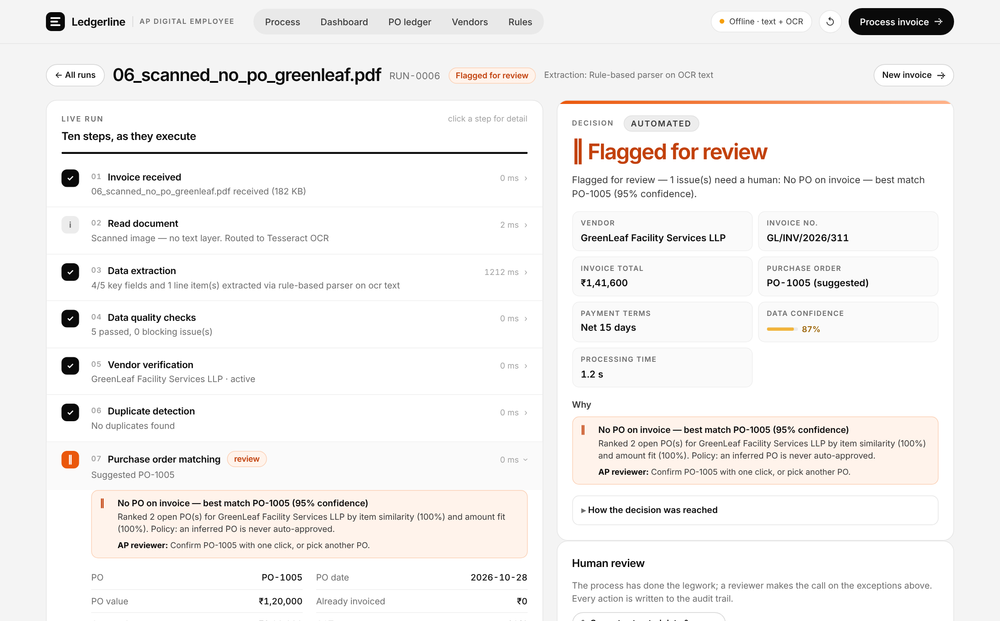
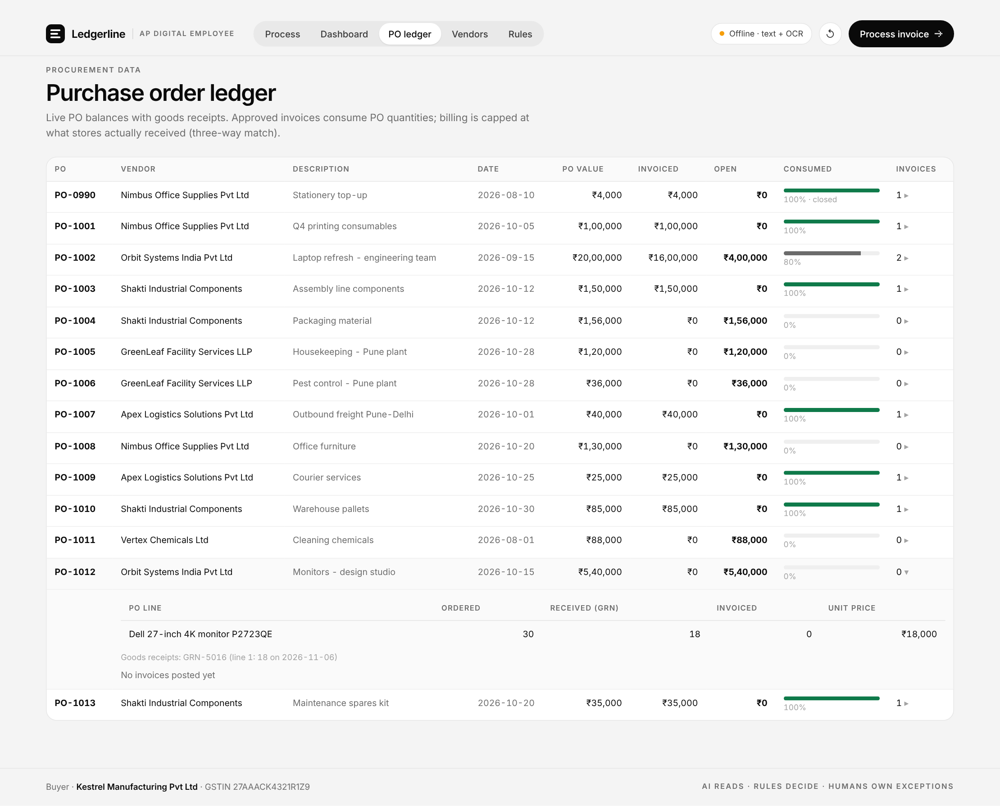
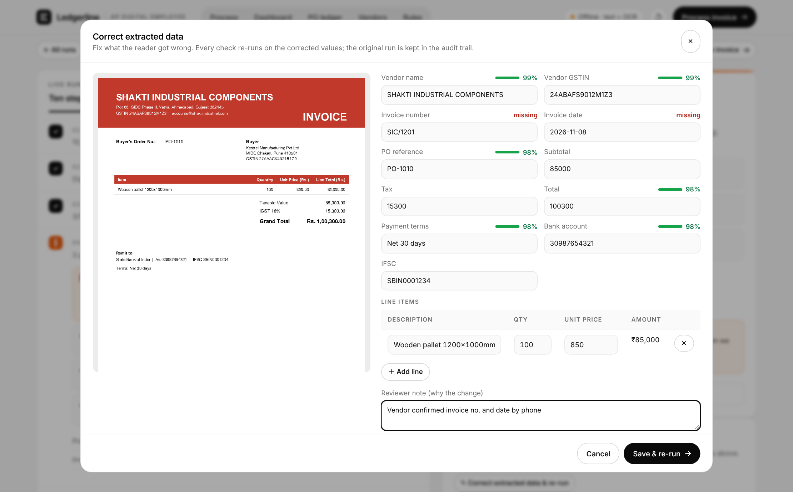
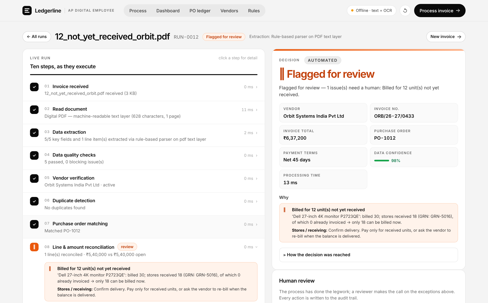

# Ledgerline — AP Invoice Agent

**Zamp AI Solutions Analyst case study · PS-1 (Finance / AP): invoice processing, from PDF to decision.**

Ledgerline takes a vendor invoice (digital PDF, scan or phone photo) and returns a clear, reasoned decision:
**Approved** (posted to the ledger and queued for payment), **Flagged for review** (routed to a named owner with the exact fix), or
**Rejected**, with every step in between visible as it runs, and a step-by-step trace of how the decision was reached.



---

## The process

```mermaid
flowchart LR
    A[Invoice PDF / scan / photo] --> B[1 Intake<br/>fingerprint]
    B --> C[2 Read<br/>text layer or scan?]
    C --> D[3 AI extraction<br/>vision LLM + rule-parser cross-check]
    D --> E[4 Data quality<br/>mandatory fields, arithmetic, dates, bill-to]
    E --> F[5 Vendor<br/>master, status, GSTIN checksum, bank]
    F --> G[6 Duplicates<br/>format-insensitive no., file hash, near-dup]
    G --> H[7 PO match<br/>explicit, or inferred + confidence]
    H --> I[8 Reconcile<br/>3-way: PO + goods receipt + invoice,<br/>price & amount tolerance, GST]
    I --> J{9 Decision}
    J -->|all pass| K[Approve → post to ledger,<br/>consume PO, schedule payment]
    J -->|any REVIEW flag| L[Route to owner + draft vendor email<br/>→ human review]
    J -->|any REJECT| M[Reject + notify]
    L -->|reviewer approves| K
    L -->|reviewer corrects a misread field| D
```



Invoices are queued and processed **one at a time in arrival order** (single upload or a batch of up to 50), so two
invoices against the same PO can never both pass against the same open balance.

**Design principle: AI reads, rules decide, humans own exceptions.**

| Layer | What does it | Why |
|---|---|---|
| Reading messy documents | Vision LLM (Gemini / Claude / OpenAI, configurable), returning a strict JSON schema with per-field confidence | Vendors format invoices differently and some are scans. That is the part that needs judgment from unstructured input. |
| Cross-check | An independent rule-based parser (PDF text layer, or Tesseract OCR for scans) | Two readers that agree give confidence. A disagreement is flagged. The parser is also the fallback if the AI API is down, so the process never stops dead. |
| Decision | Deterministic rules ([`app/rules.py`](app/rules.py)), with thresholds and duplicate rules read from [`data/seed/policy.json`](data/seed/policy.json) | Every approve / hold / reject traces to a named rule with an owner and a next action, which makes it explainable to an auditor. Nothing pays out on a model's guess. |
| Confidence | Every extracted field has a score (the AI's own score, or Tesseract's real word confidence for scans). It is capped at 50% when the two readers disagree and raised when arithmetic or master data confirms it. | A low-confidence critical field is flagged for review, so nothing pays out on a shaky read. |
| Exceptions | Human review in the UI: approve or reject with a note, confirm a suggested PO, or **correct a misread field and re-run every check** | The process does the legwork; a person makes the call on judgment cases. Every action, including field corrections (old → new), goes to the audit trail. |

## How this maps to the brief

| Brief asks for | Where it is |
|---|---|
| Live, runnable process: real input → logic → clear decision | Upload any PDF / scan / photo → 10 stages → Approved / Flagged for review / Rejected |
| Live run view | Each stage lights up as it executes; expand any stage to see its checks and data |
| Dashboard: history, status, outputs | Dashboard (KPIs, decision mix, top exception reasons, searchable run history) |
| Clean, scanned, messy, itemised vs bundled, missing-metadata invoices | Samples 01, 06, 04/05/09 (different layouts), 13 (bundled), 10 (missing number and date) |
| Reference data: vendors, POs, amounts, tolerances, duplicate rules | `data/seed/`: vendors, purchase_orders, po_lines, goods_receipts, invoice_history, **policy.json** |
| Extract vendor, invoice no., date, line items, tax, total | Stage 3 (AI vision + rule-parser cross-check, per-field confidence) |
| Duplicates, line matching, embedded vs separate tax, tolerances | Stages 6 and 8 (#07 duplicate, #09 tax-inclusive, #04/#05 tolerance) |
| Split PO / minor variations | #02 → #03 (split PO), #04 (₹800 within tolerance) |
| Decision with step-by-step reasoning | Decision card: reasons, owner and fix, plus "How the decision was reached" (8-step trace) |
| 2–4 deliberate edge cases | 12 designed; headline set: 03, 07, 08, 12 (+ 06, 10, 13) |

## Demo scenarios (in `samples/`)

Six vendors, four different invoice layouts, one phone-scan. Run them in order, because #3 depends on #2 being posted first.

| # | Scenario | What it shows | Decision |
|---|---|---|---|
| 01 | **Happy path** | Clean digital invoice, exact 2-line match to PO-1001, CGST+SGST | ✅ Approved, posted, payment due date set |
| 02 | Split PO, part 2 | 8 of 25 laptops; 12 were billed on an earlier invoice | ✅ Approved, PO ledger now shows 20/25 consumed |
| 03 | **Split PO over-billing** | 7 more laptops, but only 5 are still open | ⚑ Review → Procurement (qty and amount exceed the open balance) |
| 04 | Price within tolerance | Bracket billed ₹45.40 vs ₹45 (+0.9%), ₹800 over the PO | ✅ Approved, with a tolerance note |
| 05 | Price over tolerance | Stretch film +8% above PO price | ⚑ Review → Procurement, pinpointing the line and the ₹7,200 over-billing |
| 06 | **Scanned, no PO number** | Phone scan; PO must be inferred | ⚑ Review. Suggests PO-1005 at 95% confidence; one-click confirm by a reviewer |
| 07 | **Disguised duplicate** | `INV-0042` resubmitted; `INV42` was already paid | ❌ Rejected, with a drafted vendor email |
| 08 | **Bank details changed** | "Our bank has changed, pay the new account" (classic BEC fraud) | ⚑ Review → AP lead: verify by call-back to the number in the vendor master |
| 09 | Tax-inclusive pricing | GST embedded in the rate; different layout | ✅ Approved after normalising to the pre-tax value |
| 10 | Missing invoice no. and date | Vendor forgot mandatory fields | ⚑ Review, with a drafted email asking the vendor to reissue |
| 11 | Blocked vendor | Vendor failed a compliance audit | ❌ Rejected → Procurement |
| 13 | Bundled lines | One lump-sum line ("maintenance spares kit") for a 3-line PO | ✅ Approved with a note: total equals the open PO value, allocated line-by-line, goods receipts checked |
| 12 | **Billed before delivery** (three-way match) | 30 monitors billed; stores have a goods receipt for only 18 | ⚑ Review → Stores / receiving: 12 units not yet received |

Two more things every scenario exercises: **payment terms** (due dates use the vendor's *agreed* terms; #09 prints "Due on
receipt" against an agreed Net 30, so it is noted and scheduled at Net 30) and **reviewer correction** (#10: type in the
missing invoice number and date → the invoice re-runs and is approved, and the original run is kept as "superseded").

The **headline edge cases** for the demo are 03, 06, 07, 08 and 12. Each reflects a real, expensive AP failure:
over-billing on partial deliveries, missing PO references, duplicate payment, payment-redirection fraud, and paying for
goods that never arrived.

## Screens

| | |
|---|---|
|  |  |
| **Process invoice:** upload, or run from the demo library | **Dashboard:** history, KPIs, decision mix, top exception reasons |
|  |  |
| **Human review:** confirm an inferred PO | **PO ledger:** balances, goods receipts, invoices posted |
|  |  |
| **Reviewer correction:** per-field confidence, edit and re-run | **Three-way match:** billed before delivery |

## Run it locally

```bash
pip install -r requirements.txt          # Python 3.10+
# optional, for scanned invoices in offline mode:  apt install tesseract-ocr  /  brew install tesseract
cp .env.example .env                     # add GEMINI_API_KEY (free tier works) or ANTHROPIC_API_KEY / OPENAI_API_KEY
./run.sh                                 # → http://localhost:8000
python -m pytest -q                      # every scenario must produce its designed decision
```

With no API key it runs in **offline mode** (PDF text layer + Tesseract OCR). All 13 demo scenarios still work, which
gives you a safety net for the live demo if the network or API quota fails.

## Deploy (live and runnable link)

**Render (free, Docker, includes Tesseract)**
1. Push this folder to a GitHub repo.
2. In Render: **New → Blueprint**, then pick the repo (it reads `render.yaml`). Alternatively: New → Web Service → Docker.
3. Add the environment variable `GEMINI_API_KEY`. Deploy. Your link is `https://<name>.onrender.com`.
4. The free tier sleeps after inactivity: open the link about a minute before the interview.

Any Docker host works (Railway, Fly.io, Cloud Run): `docker build -t ledgerline . && docker run -p 8000:8000 -e GEMINI_API_KEY=... ledgerline`.

## Project structure

```
app/
  main.py        FastAPI: REST API + serves the UI
  pipeline.py    the 10 stages, reconciliation, decision, routing, human review
  extract.py     document reading, LLM extraction prompt/schema, rule-based parser, OCR, cross-check
  llm.py         Gemini / Claude / OpenAI provider layer (+ fallback model on 404)
  rules.py       thresholds and the plain-English rulebook (configurable via env)
  gstin.py       GSTIN format + checksum validation
  db.py          SQLite: vendor master, POs, invoice ledger, runs + audit trail
static/          single-page UI (vanilla JS, no build step)
data/seed/       reference dataset: vendor master (incl. payment terms), POs, goods receipts (GRN), invoice history,
                 policy.json (tolerance thresholds + duplicate-detection rules, editable by finance)
samples/         13 demo invoices
scripts/         seed_data.py + make_invoices.py regenerate the test data
tests/           end-to-end scenario tests
```

## API

`POST /api/runs/upload` (one file) · `POST /api/runs/batch` (many files) · `POST /api/runs/sample` ·
`GET /api/runs/{id}` (live stages) · `POST /api/runs/{id}/review` · `POST /api/runs/{id}/correct` · `GET /api/runs` · `GET /api/stats` · `GET /api/ledger` · `GET /api/config` · `POST /api/reset`

## Limitations and what I'd build next

- **Intake:** pull invoices automatically from an AP mailbox (Gmail / Outlook webhook) instead of uploads.
- **Multi-page and multi-currency invoices**, credit notes, TDS deductions, and service-entry sheets for service POs.
- **A scalable queue** (Redis / Celery with per-PO locking) instead of the single in-process worker.
- **Learning loop:** use reviewer decisions to tune tolerances per vendor and to improve PO inference.
- **ERP connectors** (Tally / SAP / NetSuite) to read POs and post approved invoices, plus role-based access and SSO.
- **GSTIN live verification** against the GST portal, and e-invoice IRN / QR validation.

See [ASSUMPTIONS.md](ASSUMPTIONS.md) for the assumptions and [DEMO_SCRIPT.md](DEMO_SCRIPT.md) for the demo plan.
